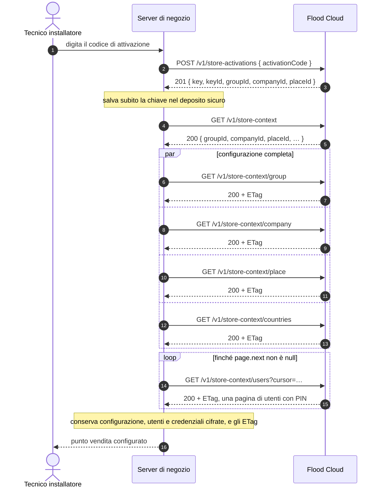

# Flood Cloud — API per il server di punto vendita

Documento per chi sviluppa il **server di punto vendita**: descrive solo le chiamate che il server di negozio può fare al cloud con la propria **chiave di negozio**. Si aggiorna a ogni passo che apre una nuova chiamata al negozio (registro in fondo).

- **Stato:** attivazione, contesto, configurazione completa di gruppo, azienda e punto vendita, paesi e province, utenti del punto vendita, catalogo del punto vendita (lettura di prodotti, categorie, reparti, marche e gruppi di attributi; scrittura di prodotti, categorie e marche).
- **Non è qui:** le API del backoffice (`doc/API.md`) e le API pubbliche per gli integratori (`doc/Public-API.md`).

## 1. Convenzioni

- **Indirizzo di base:** `https://<host>/v1`. L'host di ogni ambiente viene comunicato a parte; si usa solo HTTPS, con verifica del certificato obbligatoria.
- **Formato:** JSON UTF-8 (`Content-Type: application/json`), body non compresso.
- **Risposte:** `{ "data": … }`; le liste aggiungono `page`.
- **Errori:** `{ "error": { "code": "…", "message": "…", "details": [ … ] } }`. Si decide in base a `code` e allo stato HTTP, mai al testo di `message`.
- **Date:** ISO 8601 in UTC. **Importi:** interi in centesimi, **tranne i prezzi del catalogo (§4.9), che sono in unità di valuta decimali** (per esempio `12.2` euro, non `1220`). **Identificativi:** stringhe, da trattare come opache.
- **`X-Request-Id`:** ogni risposta lo porta; va scritto nei log del server di negozio e indicato nelle segnalazioni.
- **Cache:** ogni risposta è `Cache-Control: no-store`.

## 2. Come funziona l'accesso

Ogni punto vendita ha **una sola chiave attiva**. La chiave identifica il punto vendita, non una persona: per ottenerla non serve alcun login.

1. Dal backoffice un amministratore di piattaforma o un rivenditore genera il **codice di attivazione** del punto vendita (scheda del punto vendita, "Impostazioni rivenditore"). Il codice vale **24 ore**, per **un solo uso**, e si vede una sola volta.
2. Il tecnico installatore lo digita sul server di negozio.
3. Il server di negozio lo scambia con la chiave: `POST /v1/store-activations` (§4.1).
4. Da quel momento ogni richiesta porta l'header `Authorization: Bearer fc_sk_…`.

Una nuova attivazione dello stesso punto vendita **revoca subito** la chiave precedente. La chiave non scade: vale finché non viene revocata.

### Regole per chi scrive il server di negozio

- Conservare la chiave nel **deposito sicuro del sistema operativo** (Keychain, DPAPI, Android Keystore, libsecret), mai in chiaro su file o database.
- Non scrivere mai la chiave nei log e non mandarla ai dispositivi del negozio (casse, palmari).
- Mandarla solo nell'header `Authorization`, mai nell'URL o nel body.
- Su `403 STORE_DISABLED` **non cancellare la chiave** (§5).
- Considerare la chiave persa solo su `401`.

### Regole per le credenziali ricevute

Le chiamate dei §4.3, §4.5 e §4.7 consegnano al server di negozio **credenziali in chiaro** (pagamenti, integrazioni, casse automatiche, `legacyApiKey`, PIN degli utenti). Chi le riceve ne è responsabile:

- **Conservazione:** cifrate a riposo, mai in chiaro su file o database; mai in backup non cifrati.
- **Log:** mai nei log, nei crash report o negli strumenti di monitoraggio degli errori (Sentry compreso). Non si scrivono nei log nemmeno i corpi delle risposte dei §4.3–4.5 e §4.7, né gli header `ETag` e `If-None-Match`.
- **Dispositivi del negozio:** a una cassa o a un palmare va solo la credenziale che serve a quel dispositivo, mai la risposta intera e mai `legacyApiKey`.
- **Su `401`:** insieme alla chiave di negozio si cancellano anche le credenziali conservate.
- **Compromissione:** revocare la chiave di negozio ferma le nuove letture ma **non invalida le credenziali già scaricate**. Se un server di negozio è stato compromesso va segnalato subito: le credenziali vanno cambiate presso i fornitori.

## 3. Prima configurazione: la sequenza

È ciò che il server di negozio fa la prima volta, dal codice digitato dal tecnico fino ad avere tutta la configurazione. Nessun utente fa login in questa fase.



| Passo | Chiamata | Cosa fa il server di negozio | Se fallisce |
|---|---|---|---|
| 1 | — | Chiede al tecnico il codice di attivazione, generato dal backoffice (vale 24 ore, un solo uso). | — |
| 2 | `POST /v1/store-activations` (§4.1) | Manda il codice, senza credenziali. | `401`: codice non valido o scaduto, se ne chiede un altro. Risposta persa o `5xx`: **non riprovare**, serve un nuovo codice. |
| 3 | — | Salva la chiave `fc_sk_…` nel deposito sicuro **prima di ogni altra cosa**: non si può richiedere di nuovo. | Se il salvataggio fallisce serve un nuovo codice. |
| 4 | `GET /v1/store-context` (§4.2) | Verifica che la chiave funzioni e legge gli identificativi di gruppo, azienda e punto vendita. | Stati del §5. |
| 5 | `GET /v1/store-context/group` (§4.3), `/company` (§4.4), `/place` (§4.5), `/countries` (§4.6) | Legge la configurazione completa dei tre oggetti e l'elenco dei paesi; le chiamate sono indipendenti e si possono fare in parallelo. | Si ripete la sola chiamata fallita. |
| 6 | `GET /v1/store-context/users` (§4.7) | Legge gli utenti del punto vendita, una pagina alla volta finché `page.next` non è `null`. | Si riprende dall'ultima pagina letta. |
| 7 | — | Conserva configurazione e utenti, con credenziali e PIN cifrati (§2), e l'`ETag` di ciascuna risposta. Il punto vendita è configurato. | — |

**Agli avvii successivi** si riparte dal passo 4 con la chiave già salvata. **Durante il funzionamento** si ripetono le chiamate dei passi 5 e 6 con `If-None-Match` (§4.8): `304` significa che nulla è cambiato.

**Una sola chiamata per oggetto.** Il punto vendita si legge solo con `GET /v1/store-context/place`: la risposta è completa e non servono altre chiamate.

## 4. Chiamate disponibili

### 4.1 Attivazione — `POST /v1/store-activations`

Scambia il codice di attivazione con la chiave. È l'unica chiamata **senza credenziale**.

- **Limiti:** 10 richieste al minuto per indirizzo IP; body di al più 2 KB.
- **Body:**
  ```json
  {
    "activationCode": "7KQ2-M9XD-4TPA-H3WN",
    "installation": { "appVersion": "2.0.1", "platform": "windows" }
  }
  ```
  - `activationCode` (obbligatorio): come lo digita una persona. Maiuscole e minuscole sono equivalenti, trattini e spazi sono facoltativi, `O` vale `0`, `I` e `L` valgono `1`.
  - `installation` (facoltativo): `appVersion` e `platform`, stringhe di al più 64 caratteri (lettere, cifre, spazio e `. _ + -`). Servono alla diagnostica.
  - Ogni altra proprietà è rifiutata con `422`.
- **Risposta:** `201`, con `Location: /v1/store-context`
  ```json
  {
    "data": {
      "key": "fc_sk_…",
      "keyId": "6650…",
      "groupId": "665f…",
      "companyId": "665f…",
      "placeId": "665f…"
    }
  }
  ```
  `key` arriva **solo in questa risposta**: il cloud non la conserva in chiaro e non può rimandarla.
- **Errori:**

  | Stato | `code` | Significato |
  |---|---|---|
  | `401` | `INVALID_CREDENTIALS` | Codice non valido. La risposta è identica per codice errato, scaduto, già usato o punto vendita non operativo: il server di negozio mostra un solo messaggio ("codice non valido o scaduto"). |
  | `413` | `PAYLOAD_TOO_LARGE` | Body oltre 2 KB. |
  | `415` | `UNSUPPORTED_MEDIA_TYPE` | Content type diverso da JSON, o body compresso. |
  | `422` | `VALIDATION_ERROR` | Body malformato; `details` indica il campo. |
  | `429` | `RATE_LIMITED` | Troppe richieste: riprovare dopo i secondi di `Retry-After`. |

**Attenzione alla risposta persa.** Il codice si consuma al primo scambio riuscito. Se il server di negozio non riceve la risposta (rete caduta, errore `5xx`), il codice può essere già consumato: **non va riprovato in automatico**, serve un nuovo codice dal backoffice. Per questo la chiave va salvata nel deposito sicuro **prima** di ogni altra operazione.

### 4.2 Contesto — `GET /v1/store-context`

Dice a quale gruppo, azienda e punto vendita appartiene la chiave. Serve a verificare la chiave all'avvio e a conoscere l'azienda attuale del punto vendita.

- **Autenticazione:** chiave di negozio.
- **Risposta:** `200`
  ```json
  {
    "data": {
      "groupId": "665f…",
      "companyId": "665f…",
      "placeId": "665f…",
      "keyId": "6650…",
      "activatedAt": "2026-11-13T10:00:00.000Z"
    }
  }
  ```
  `companyId` può cambiare nel tempo (il punto vendita può essere spostato su un'altra azienda dello stesso gruppo): va riletto a ogni avvio.
- **Errori:** quelli del §5.

### 4.3 Configurazione del gruppo — `GET /v1/store-context/group`

Tutta la configurazione del gruppo del punto vendita, comprese le chiavi delle integrazioni. Nessun parametro: il gruppo è quello della chiave.

- **Autenticazione:** chiave di negozio. **Header di risposta:** `ETag`, un valore opaco che cambia quando cambia la configurazione; con `If-None-Match` uguale la risposta è `304` senza corpo: si può usare per sapere se la configurazione è cambiata. La risposta non è mai compressa e non va conservata nei log.
- **Risposta:** `200`. Campi di primo livello:
  ```json
  {
    "data": {
      "id": "665f…", "name": "Gruppo Rossi", "description": null,
      "status": "active", "trashed": false, "trashedAt": null, "demo": false,
      "features": { "…": true },
      "languages": ["it", "en"],
      "statsSettings": { "openingTime": "06:30", "compressProductsCategories": false, "timeSlots": [{ "from": "00:00", "to": "06:00" }] },
      "integrations": {
        "easyappear": { "enabled": false, "apiKey": null },
        "yellgo": { "enabled": true, "apiKey": "…" }
      },
      "legacyApiKey": "…",
      "priceLists": [], "taxes": [], "currencies": [], "measureUnits": [], "warehouseRules": [], "fidelityCardRules": [],
      "cardTypes": [], "pointsCollections": [], "prizeCatalogues": [], "productFavorites": [], "promotions": [],
      "createdAt": "2024-01-15T10:00:00.000Z", "updatedAt": "2026-11-13T09:30:00.000Z"
    }
  }
  ```
  `integrations` ha una voce per ogni integrazione prevista, con l'interruttore (`enabled`) e la chiave in chiaro (`apiKey`, `null` se manca). I cataloghi sono elenchi con gli stessi nomi e la stessa forma delle rispettive risorse del backoffice (`doc/API.md`). Sono quelli **dell'intero gruppo**: promozioni, tipi di carta e gruppi preferiti arrivano anche se riguardano altri punti vendita, e il server di negozio usa quelli che valgono per il proprio.
- **`legacyApiKey` è temporaneo:** serve finché le chiamate al vecchio servizio non sono migrate; poi verrà rimosso. Vale per **tutto il gruppo**, non per il solo punto vendita: va protetto come la credenziale più delicata, non va usato per altro né inoltrato ai dispositivi del negozio.
- **Cosa non arriva mai:** tutto ciò che riguarda le API pubbliche del gruppo, il rivenditore e l'infrastruttura.
- **Errori:** quelli del §5.

### 4.4 Configurazione dell'azienda — `GET /v1/store-context/company`

Tutta la configurazione dell'azienda **attuale** del punto vendita (se il punto vendita passa a un'altra azienda, la chiamata restituisce la nuova). Nessun parametro.

- **Autenticazione:** chiave di negozio. **Header di risposta:** `ETag`, la versione del documento (forte); `If-None-Match` uguale dà `304` senza corpo.
- **Risposta:** `200`. Campi di primo livello:
  ```json
  {
    "data": {
      "id": "665f…", "groupId": "665f…", "name": "Rossi S.r.l.",
      "vatNumber": "01234567890", "fiscalCode": null,
      "address": { "street": "Via Roma 1", "postcode": "20100", "city": "Milano", "province": "MI", "country": "IT" },
      "currency": "EUR", "email": null, "phone": null, "status": "active",
      "trashed": false, "trashedAt": null, "expirationDate": null,
      "createdAt": "2024-01-15T10:00:00.000Z", "updatedAt": "2026-11-13T09:30:00.000Z",
      "eInvoicing": { "…": "…" },
      "invoiceNumbering": { "position": "prefix", "values": [{ "name": "FE", "cash": false }], "lastInvoiceNumber": 12, "discountLines": false, "cervedLookup": false },
      "bankAccounts": [], "mealVoucherIssuers": [],
      "customerApp": { "…": "…" },
      "media": { "…": "…" }
    }
  }
  ```
  I nomi e la forma dei campi sono quelli del backoffice (`doc/API.md`, sezione "Aziende").
- **Errori:** quelli del §5.

### 4.5 Configurazione del punto vendita — `GET /v1/store-context/place`

Tutta la configurazione del proprio punto vendita, **con le credenziali di integrazioni e dispositivi in chiaro** e le impostazioni del rivenditore. Nessun parametro.

- **Autenticazione:** chiave di negozio. **Header di risposta:** `ETag`, la versione del documento (forte); `If-None-Match` uguale dà `304` senza corpo. La risposta non è mai compressa e non va conservata nei log.
- **Risposta:** `200`. Contiene l'anagrafica (`name`, `address`, contatti, listini), `license`, `openingHours`, i blocchi delle impostazioni (cassa, stampe, pagamenti, sale, prenotazioni, asporto e consegna, self ordering, kiosk, appuntamenti, display, fidelity, tabacchi, media), `devices`, `printStations`, `rooms`, `storages`, `integrations` e `dealerSettings`. I nomi e la forma dei campi sono quelli del backoffice (`doc/API.md`, sezioni "Punti vendita" e "Impostazioni del punto vendita"), con una differenza: dove il backoffice ha l'indicatore `<nome>Set`, qui c'è `<nome>` con il valore della credenziale, oppure `null` se manca. Estratto:
  ```json
  {
    "data": {
      "id": "665f…", "groupId": "665f…", "companyId": "665f…", "name": "Bar Roma",
      "address": { "street": "Via Roma 1", "postcode": "20100", "city": "Milano", "province": "MI", "country": "IT" },
      "priceListId": "665f…", "invoiceSeries": "FE",
      "license": { "plan": "advanced", "expirationDate": "2030-01-01T00:00:00.000Z", "status": "active", "sentry": false },
      "openingHours": { "timezone": "Europe/Rome", "week": { "…": "…" }, "special": { "…": "…" } },
      "integrations": {
        "dojo": { "status": true, "apiKey": "…" },
        "floodPay": { "status": true, "stripe": { "publicKey": "…", "privateKey": "…", "webhookPrivateKey": null } }
      },
      "devices": {
        "items": [{ "id": "d1", "type": "desk", "name": "Cassa", "automaticCashUsername": "…", "automaticCashPassword": "…" }],
        "editable": true
      },
      "dealerSettings": { "sentry": false, "serverIp": "10.0.0.1", "connectorAddress": "" }
    }
  }
  ```
  I valori assenti o non validi arrivano come `null`, `false` o `[]`.
- **Errori:** quelli del §5.

### 4.6 Paesi e province — `GET /v1/store-context/countries`

L'elenco dei paesi con le loro province, lo stesso per tutta la piattaforma. Serve per indirizzi e anagrafiche. Nessun parametro: eventuali parametri nella query sono ignorati.

- **Autenticazione:** chiave di negozio. **Header di risposta:** `ETag`; con `If-None-Match` uguale la risposta è `304` senza corpo.
- **Risposta:** `200`, tutto in una sola risposta (al più 400 paesi), in ordine di nome:
  ```json
  {
    "data": [
      { "code": "IT", "name": "Italia", "areas": [{ "code": "MI", "name": "Milano" }, { "code": "RM", "name": "Roma" }] }
    ],
    "page": { "limit": 1, "next": null }
  }
  ```
  `code` è il codice del paese, `areas` le sue province (codice e nome). `page.next` è sempre `null`: non c'è paginazione.
- **Errori:** quelli del §5.

### 4.7 Utenti del punto vendita — `GET /v1/store-context/users`

Gli utenti che operano sul punto vendita, con il loro **PIN in chiaro**. La password non arriva mai, in nessuna forma.

- **Chi c'è nell'elenco:**
  - i dipendenti (`E`) e gli amministratori di punto vendita (`PA`) assegnati a questo punto vendita;
  - gli amministratori dell'azienda (`CA`) dell'azienda attuale del punto vendita;
  - gli amministratori del gruppo (`SA`).

  Non ci sono mai gli amministratori di piattaforma, i rivenditori, gli utenti nel cestino e quelli di altri punti vendita. Gli utenti **disattivati** ci sono, con `status: "disabled"`: il server di negozio non deve farli accedere.
- **Autenticazione:** chiave di negozio. La risposta non è mai compressa e non va conservata nei log.
- **Parametri della query:** solo questi due; ogni altro parametro dà `422`.

  | Parametro | Valori | Significato |
  |---|---|---|
  | `limit` | 1–200, default 50 | Utenti per pagina. |
  | `cursor` | il valore di `page.next` della pagina precedente | Va passato così com'è, senza interpretarlo. Un cursore non valido dà `422`. |
- **Risposta:** `200`, in ordine di nome utente. Si chiede la pagina successiva finché `page.next` non è `null`.
  ```json
  {
    "data": [
      {
        "id": "665f…", "username": "mario.rossi", "firstName": "Mario", "lastName": "Rossi",
        "email": "mario@esempio.it", "phone": null,
        "role": "E", "status": "active", "trashed": false, "trashedAt": null,
        "groupId": "665f…", "companyIds": ["665f…"], "placeIds": ["665f…"],
        "language": "it", "theme": "system", "hiddenInStats": false, "description": null, "hasAvatar": false,
        "pin": "1234",
        "serviceIds": [],
        "permissions": { "…": "…" },
        "pos": { "enabled": true, "grants": { "discount": true, "cashEnabled": true, "handheldEnabled": true }, "options": { "productsColorStyle": "line" } },
        "shiftTime": { "…": "…" },
        "createdAt": "2025-03-01T09:00:00.000Z", "updatedAt": "2026-11-13T09:30:00.000Z"
      }
    ],
    "page": { "limit": 50, "next": null }
  }
  ```
  - `pin`: il PIN come stringa (3–6 cifre), oppure `null` se l'utente non ne ha uno.
  - `role`: `E`, `PA`, `CA` o `SA`.
  - `pos`: abilitazione, permessi (`grants`) e preferenze (`options`) dell'app di cassa e del palmare.
  - I nomi e la forma degli altri campi sono quelli della scheda utente del backoffice (`doc/API.md`, sezione "Gestione utenti").
- **Header di risposta:** `ETag` per ogni pagina, un valore opaco; con `If-None-Match` uguale la risposta è `304` senza corpo. Per sapere se qualcosa è cambiato va ricontrollata ogni pagina.
- **Il PIN è una credenziale:** valgono le regole del §2 (cifrato a riposo, mai nei log, ai dispositivi solo ciò che serve).
- **Errori:** quelli del §5; `422 VALIDATION_ERROR` per parametri non ammessi.

### 4.8 Quando rileggere

Le chiamate dei §4.3–4.7 sono pensate per essere interrogate periodicamente: con `If-None-Match` uguale all'ultimo `ETag` la risposta è `304` senza corpo e non si perde nulla. Si rileggono comunque all'avvio e dopo ogni `403 STORE_DISABLED` risolto. Contano nel limite di 600 richieste al minuto della chiave (§5).

### 4.9 Catalogo del punto vendita — `/v1/store-context/catalog/…`

Il catalogo che il server di negozio scarica e, per i prodotti, le categorie e le marche, modifica. Tutte le chiamate usano la **chiave di negozio**; il punto vendita, l'azienda e il gruppo sono sempre quelli della chiave: **nessun parametro li sceglie** (un parametro che non è nelle tabelle qui sotto dà `422`).

> **Prezzi.** I prezzi del catalogo sono in **unità di valuta decimali** (`"net": 10`, `"gross": 12.2` per 12,20 euro), come li usa il POS, e non in centesimi come gli altri importi di questo documento. `net` è l'imponibile, `gross` l'importo con IVA.

- **Che cosa si vede.** Le voci **disponibili nel proprio punto vendita** o per **tutti** i punti vendita. Una voce di un altro punto vendita non esiste per il negozio (`404`). Dei dati per punto vendita (`places`, postazioni di stampa `printStations`/`counterPrintStations`, `stock`) si vedono **solo quelli del proprio punto vendita**.
- **Forma dei dati.** Le stesse rappresentazioni del backoffice (`doc/API.md`, "Catalogo") viste dal punto vendita; nei prodotti **non ci sono** `costs`, `suppliers` e `simpleCost` (costi e fornitori sono dati dell'intero gruppo) e `warnings` non nomina gli altri prodotti. I campi che dipendono dalle funzioni del gruppo (`cash`, `warehouse`, `rooms`, `media`…) ci sono solo se il gruppo le ha. `editable` dice se il negozio può modificare la voce **per intero**; `placeEditable` se può modificare almeno i dati del proprio punto vendita.
- **Una voce "per tutti" con un solo punto vendita.** Se il gruppo ha **un solo punto vendita fuori dal cestino** (il cloud lo verifica in modo prudente: nel dubbio valgono le regole di due punti vendita), una voce per tutti (`places`/`placeIds` vuoto) è interamente del negozio (`editable: true`) e se ne può anche creare una. Con due o più punti vendita una voce per tutti è in sola lettura per i campi comuni (`403 FORBIDDEN` con il nome del campo) e non se ne può creare. La regola si valuta a ogni richiesta: appena nasce un secondo punto vendita, la richiesta successiva torna alle regole di due punti vendita. **Attenzione:** una voce creata "per tutti" quando il gruppo ha un solo punto vendita **diventa visibile e disponibile anche al secondo punto vendita** quando nasce (e per quest'ultimo è in sola lettura nei campi comuni).

#### Letture

Nessuna lettura chiede l'operatore. Ogni elenco è a pagine con cursore (`page.next`, da passare così com'è come `cursor`; un cursore non valido dà `422`): il catalogo non arriva mai in una sola risposta.

| Chiamata | Query ammessa | Note |
|---|---|---|
| `GET /v1/store-context/catalog/products` | `limit` 1–**50** (default 25), `cursor`, `family` (`products`, `services`, `tgm`, `modifiers`; senza, tutte), `updatedSince` | Prodotti **interi**, dal meno recente al più recente per data di modifica (`updatedAt`). |
| `GET /v1/store-context/catalog/products/{productId}` | — | Il prodotto con l'`ETag` della sua versione (l'`If-Match` della scrittura successiva) e i `warnings` dei duplicati. |
| `GET /v1/store-context/catalog/categories` | `limit` 1–**100** (default 50), `cursor`, `updatedSince` | Dal meno recente al più recente. Ogni categoria ha anche `parentId`, `depth`, `parentHidden`, `cyclic`. |
| `GET /v1/store-context/catalog/categories/tree` | — | Albero compatto (`{ id, name, parentId, position, enabled, children }`), con `ETag` debole e `304`. `409 CONFLICT` (`categories`/`tooMany`) in un gruppo con troppe categorie. |
| `GET /v1/store-context/catalog/categories/{categoryId}` | — | La categoria con l'`ETag`. |
| `GET /v1/store-context/catalog/departments` | `limit` 1–**100** (default 50), `cursor` | Reparti per nome. `403 FEATURE_DISABLED` se il gruppo non ha la funzione `cash`. |
| `GET /v1/store-context/catalog/brands` | `limit` 1–**100** (default 50), `cursor`, `updatedSince` | Marche dal meno recente al più recente per data di modifica, **disattivate comprese** (`enabled: false`). Solo quelle del proprio punto vendita o per tutti. |
| `GET /v1/store-context/catalog/brands/{brandId}` | — | La marca con l'`ETag` della sua versione. |
| `GET /v1/store-context/catalog/attribute-groups` | `limit` 1–**100** (default 50), `cursor`, `updatedSince` | Gruppi di attributi (ognuno con i propri attributi) dal meno recente al più recente. |
| `GET /v1/store-context/catalog/attribute-groups/{attributeGroupId}` | — | Il gruppo con l'`ETag`. |

I gruppi di attributi sono **di sola lettura** per il negozio: li scrivono solo l'amministratore di piattaforma, il rivenditore e l'amministratore del gruppo dal backoffice. Listini, aliquote e gruppi preferiti non sono qui: arrivano con la configurazione del gruppo (§4.3).

**`updatedSince`** è un istante ISO 8601 (`2026-11-23T10:00:00.000Z`, oppure solo la data). Restituisce ogni voce **modificata da quell'istante in poi (compreso)**, **anche quelle disattivate (`enabled: false`) e quelle nel cestino (`trashed: true`)**, perché il negozio le tolga dalla propria copia. Senza `updatedSince` i prodotti nel cestino non ci sono (quelli disattivati sì).

**Primo scaricamento.**
1. `GET /store-context/group` (§4.3): listini, aliquote, gruppi preferiti, lingue, funzioni.
2. `GET /store-context/catalog/categories` a pagine, fino a `page.next: null`; poi, se serve, `…/categories/tree`.
3. `GET /store-context/catalog/departments` a pagine.
4. `GET /store-context/catalog/products?limit=50` a pagine, senza `updatedSince` e senza `family` (o una famiglia alla volta).
5. Si conserva il **più grande `updatedAt`** visto tra prodotti e categorie (per ciascuno dei due elenchi).

**Aggiornamento incrementale.** Si ripetono le chiamate dei punti 2 e 4 con `updatedSince=<il più grande updatedAt conservato>`. La voce con quello stesso `updatedAt` torna: si confronta per `id`. Per ogni voce ricevuta: se `trashed` è `true` o `enabled` è `false` la si toglie dalle vendite, altrimenti la si sostituisce. Un prodotto modificato mentre si leggono le pagine passa in fondo all'elenco: si legge una volta in più, mai si perde. Una rilettura completa periodica (per esempio notturna) resta la rete di sicurezza: le voci scritte da programmi che non aggiornano la data di modifica non compaiono nell'incrementale.

**Esempio — un prodotto** (`GET /v1/store-context/catalog/products?limit=1`):
```json
{
  "data": [
    {
      "id": "665f…", "family": "products", "type": "product", "isModifier": false, "enabled": true,
      "code": "ACQ", "name": { "it": "Acqua" }, "shortName": { "it": "Acqua" }, "description": { "it": "" }, "shortDescription": { "it": "" },
      "favorite": false, "generic": false, "toCheck": false, "noDiscount": false,
      "brandId": null, "categoryIds": ["665f…"], "attributeIds": [], "position": null, "productionValue": null,
      "availability": { "pos": true, "warehouse": true },
      "integrations": { "floodOrders": false, "yellgo": false, "leggimenu": false },
      "validFrom": null, "validTo": null,
      "loadUnit": "pz", "unloadUnit": "pz", "conversionRatio": 1,
      "colors": { "text": "#000000", "background": "#ffffff" },
      "barcodes": [{ "value": "8000000000001", "loadQuantity": null, "saleQuantity": 1 }],
      "prices": [
        {
          "id": "price-1", "priceListId": "list-1", "currency": "EUR", "taxId": "tax-001",
          "tax": { "rate": 22, "department": 1, "description": "Ordinaria", "vatNature": null },
          "net": 10, "gross": 12.2, "discount": 0,
          "validFrom": null, "validTo": null, "dailyFrom": null, "dailyTo": null, "weekDays": [], "fromQuantity": 1, "maxSaleQuantity": null
        }
      ],
      "places": [{ "placeId": "665f…", "favorite": true, "favoriteHandheld": false, "position": null, "productionCenterId": null }],
      "stock": { "665f…": { "665f…": { "quantity": 4, "min": 1, "max": 9, "location": "A1" } } },
      "shipping": { "width": null, "height": null, "depth": null, "weight": null },
      "components": [], "menu": [], "modularPriceRule": null,
      "editable": true, "placeEditable": true, "trashed": false, "trashedAt": null,
      "createdAt": "2024-03-01T09:00:00.000Z", "updatedAt": "2026-11-20T09:00:00.000Z"
    }
  ],
  "page": { "limit": 1, "next": "eyJ2ZXIiOjEs…" }
}
```
`stock` ha come chiavi l'id del **proprio** punto vendita e, sotto, gli id dei depositi. I campi `requiredModifierIds`, `modifierIds`, `excludedModifierIds` e `modifierCategoryIds` ci sono se il gruppo ha le varianti.

**Esempio — una categoria** (`GET /v1/store-context/catalog/categories`):
```json
{
  "data": [
    {
      "id": "665f…", "name": { "it": "Bevande" }, "description": { "it": "" }, "enabled": true, "position": 1, "productionValue": null,
      "availability": { "pos": true }, "noDiscount": false, "requiresLegalAge": false,
      "integrations": { "floodOrders": false, "yellgo": false, "leggimenu": false },
      "backgroundColor": "#000000", "textColor": "#000000",
      "places": [{ "placeId": "665f…", "position": 1, "productionCenterId": null }],
      "editable": true,
      "createdAt": "2024-03-01T09:00:00.000Z", "updatedAt": "2026-11-20T09:00:00.000Z",
      "parentId": null, "parentHidden": false, "depth": 0, "cyclic": false
    }
  ],
  "page": { "limit": 50, "next": null }
}
```
**Esempio — una marca** (`GET /v1/store-context/catalog/brands`): `{ "id": "665f…", "name": { "it": "Acme" }, "description": { "it": "" }, "enabled": true, "placeIds": ["665f…"], "editable": true, "createdAt": "…", "updatedAt": "…" }` (con la funzione `media` c'è anche `image`, che il negozio può leggere ma non scrivere). **Esempio — un gruppo di attributi** (`GET /v1/store-context/catalog/attribute-groups`): `{ "id": "665f…", "name": { "it": "Taglie" }, "attributes": [{ "id": "a1b2…", "name": { "it": "S" } }, { "id": "c3d4…", "name": { "it": "M" } }], "editable": false, "createdAt": null, "updatedAt": "…" }`.

**Esempio — l'albero:** `{ "data": [{ "id": "665f…", "name": "Bevande", "parentId": null, "parentHidden": false, "position": 1, "enabled": true, "children": [] }] }`. **Esempio — un reparto:** `{ "id": "665f…", "code": 5, "taxId": "tax-001", "tax": { "rate": 22, "department": 1, "vatNature": null, "description": null }, "noDiscount": false, "secondaryFiscalPrinter": false, "name": { "it": "Reparto 1" }, "description": { "it": "" }, "enabled": true, "placeIds": [], "editable": false, "createdAt": "…", "updatedAt": "…" }`.

#### Scritture

Si possono **creare, modificare, duplicare, cestinare e ripristinare i prodotti** (le varianti sono prodotti) e **creare, modificare ed eliminare le categorie e le marche**. **Non** esistono: l'eliminazione definitiva di un prodotto, lo svuotamento del cestino, le scritture su reparti e gruppi di attributi. Il cambio dei prezzi è una modifica del prodotto (`prices`).

| Chiamata | Header richiesti | Corpo | Risposta |
|---|---|---|---|
| `POST /v1/store-context/catalog/products` | `X-Operator-Id`, `Idempotency-Key` | il prodotto (stesso corpo della creazione del backoffice, `doc/API.md`, "Prodotti") | `201`, `Location`, `ETag` |
| `PATCH /v1/store-context/catalog/products/{productId}` | `X-Operator-Id`, `If-Match` | i campi da cambiare (JSON Merge Patch sui testi e sulle liste come nel backoffice) | `200`, `ETag` |
| `POST …/products/{productId}/duplicate` | `X-Operator-Id`, `Idempotency-Key` | nessuno | `201`, `Location` del nuovo prodotto |
| `POST …/products/{productId}/trash` | `X-Operator-Id`, `If-Match` | nessuno | `200` |
| `POST …/products/{productId}/restore` | `X-Operator-Id`, `If-Match` | nessuno | `200` |
| `POST /v1/store-context/catalog/categories` | `X-Operator-Id`, `Idempotency-Key` | la categoria (come nel backoffice, "Categorie") | `201`, `Location`, `ETag` |
| `PATCH …/categories/{categoryId}` | `X-Operator-Id`, `If-Match` | i campi da cambiare | `200`, `ETag` |
| `DELETE …/categories/{categoryId}` | `X-Operator-Id` | nessuno | `204`; `409` se qualcosa la usa; nessuna eliminazione a cascata, niente cicli |
| `POST /v1/store-context/catalog/brands` | `X-Operator-Id`, `Idempotency-Key` | la marca: `name` (obbligatorio, per lingua), `description`, `enabled`, `placeIds` | `201`, `Location`, `ETag` |
| `PATCH …/brands/{brandId}` | `X-Operator-Id`, `If-Match` | i campi da cambiare | `200`, `ETag` |
| `DELETE …/brands/{brandId}` | `X-Operator-Id` | nessuno | `204`; `409` se un prodotto la usa |

**Campi che il negozio non scrive.** I corpi di scrittura sono quelli del backoffice **senza** questi campi: nei prodotti `simpleCost`, `suppliers`, `image` e `gallery`; nelle categorie `image` e `icon`; nelle marche `image` (costi e fornitori sono dati dell'intero gruppo, che il negozio non legge; la libreria delle immagini non è sua). Una di queste chiavi dà `422` (`unknown`, come ogni chiave sconosciuta) e non viene scritto nulla. La **duplicazione** copia invece nel nuovo prodotto costi e fornitori del prodotto d'origine, senza mostrarli.

Le regole sono **quelle del backoffice** (stessi controlli, stessi codici): i campi che dipendono dalle funzioni del gruppo, i riferimenti che devono esistere, la **concorrenza** (`If-Match` con l'`ETag` letto: `412` se la voce è cambiata, `422` se manca o non è un tag forte), l'`Idempotency-Key` in creazione (un UUID; la stessa chiave con lo stesso corpo risponde di nuovo come la prima volta, con un corpo diverso `409`; le chiavi sono **legate alla chiave di negozio** e valgono 24 ore), i limiti di dimensione (corpo del prodotto fino a 256 KB, della categoria fino a 128 KB: oltre `413`; non JSON `415`). In scrittura il negozio può cambiare **per intero** una voce solo se `editable` è `true`; una voce condivisa con altri punti vendita (o per tutti, con due o più punti vendita) accetta soltanto i campi del proprio punto vendita (`places`, `printStations`, `counterPrintStations`, `stock` per i prodotti; per le marche nessuno: una marca condivisa o per tutti è in sola lettura) e per gli altri risponde `403 FORBIDDEN` con `details: [{ field, issue: "notAllowed" }]`. Un negozio non può dichiarare un punto vendita diverso dal proprio (`403`).

**Esempio — cambio di prezzo:**
```
PATCH /v1/store-context/catalog/products/665f…
Authorization: Bearer fc_sk_…
X-Operator-Id: 665f…
If-Match: "ofQyXEWYuR1LURZT2EB4zAb4gmcNZ2kptw2o6mGKnOE"
Content-Type: application/json

{ "prices": [{ "id": "price-1", "priceListId": "list-1", "currency": "EUR", "taxId": "tax-001", "gross": 12.5 }] }
```
→ `200` con il prodotto aggiornato e il nuovo `ETag`.

**Marche.** Valgono le stesse regole del backoffice per un amministratore di quel punto vendita: una marca **solo del proprio punto vendita** si modifica ed elimina per intero; una per tutti o condivisa con altri punti vendita è in sola lettura (`403`), salvo il caso del gruppo con un solo punto vendita (sopra); una marca usata da un prodotto non si elimina (`409`). Il corpo non ha `image` (`422`, `unknown`). La creazione deve nominare in `placeIds` il proprio punto vendita (con due o più punti vendita nel gruppo; `403` altrimenti).

**Esempio — creazione di un prodotto** (con un solo punto vendita nel gruppo `places` può mancare; con più punti vendita deve nominare il proprio):
```
POST /v1/store-context/catalog/products
X-Operator-Id: 665f…
Idempotency-Key: <UUID generato dal server di negozio>
{ "name": { "it": "Pane" }, "places": [{ "placeId": "665f…" }] }
```
→ `201`, `Location: /v1/store-context/catalog/products/665f…`, `ETag`.

#### L'operatore delle scritture

Ogni scrittura porta l'header **`X-Operator-Id`**: l'id (24 caratteri esadecimali) dell'utente che sta operando in cassa. Il cloud **lo verifica prima di leggere il corpo**:

- l'utente deve essere uno di quelli che il negozio riceve da `GET /store-context/users` (§4.7): dipendente o amministratore del punto vendita, amministratore dell'azienda del punto vendita, amministratore del gruppo; non un amministratore di piattaforma o un rivenditore, non un utente nel cestino né di altri punti vendita o gruppi;
- deve essere **attivo**;
- deve avere, nella propria matrice dei permessi, il permesso di **scrittura sui prodotti** (`permissions.products.w`, il modulo "Prodotti" della scheda utente).

Se anche una sola condizione manca (header assente o malformato, utente sconosciuto, di un altro punto vendita, disattivato, senza permesso) la risposta è **sempre la stessa**: `403`, `{ "error": { "code": "OPERATOR_NOT_ALLOWED", "message": "Operator not allowed" } }`, senza dire quale. Il server di negozio non deve interpretarla come "utente inesistente": mostra "operatore non autorizzato".

L'operatore è **dichiarato dal negozio, non autenticato dal cloud**: il cloud non ha un segreto dell'utente (il PIN lo controlla il negozio). Non concede nulla che la chiave di negozio non possa già fare; nel registro delle attività l'attore resta il negozio (con l'id della chiave) e l'operatore compare a parte (`operatorId`). Il server di negozio resta responsabile di verificare il PIN dell'operatore prima di mandare la scrittura. Chi possiede la chiave di negozio può indicare **qualunque operatore attivo del punto vendita che abbia il permesso**: `operatorId` nel registro è quindi un'indicazione, **non una prova** di chi ha agito, e la chiave va protetta di conseguenza (§2).

**Limite delle scritture.** Oltre al limite generale della chiave (§5), le scritture del catalogo hanno un limite proprio di **120 al minuto per chiave**: `429 RATE_LIMITED` con `Retry-After`. Contano anche le scritture con operatore rifiutato; le letture no.

#### Voci che escono dall'aggiornamento incrementale

L'aggiornamento con `updatedSince` **non** segnala: una voce che esce dal perimetro del punto vendita (per esempio il suo punto vendita è tolto dalla disponibilità) e una **categoria eliminata**. Non compaiono più né in elenco né come cestinate. Per toglierle dalla propria copia serve la **rilettura completa periodica** (ricostruire l'elenco e scartare gli id non più presenti).


## 5. Stati ed errori di ogni chiamata autenticata

| Stato | `code` | Quando | Cosa fa il server di negozio |
|---|---|---|---|
| `401` | `UNAUTHENTICATED` | Chiave assente, malformata, sconosciuta o **revocata**. Succede anche se il punto vendita è stato messo nel cestino o eliminato, o se è stata fatta una nuova attivazione. | La chiave è persa: chiede una nuova attivazione. |
| `403` | `STORE_DISABLED` | La chiave è valida ma il punto vendita non è operativo: gruppo sospeso o nel cestino, punto vendita disattivato, licenza scaduta, azienda nel cestino. | **Tiene la chiave**, avvisa l'operatore e riprova più tardi: riprende da solo dopo riattivazione, ripristino o rinnovo. |
| `403` | `FORBIDDEN` | La chiamata non è aperta al server di negozio; oppure, nel catalogo, un campo di una voce condivisa con altri punti vendita (`details` nomina il campo). | Errore di integrazione, o per i campi condivisi: si possono cambiare solo i dati del proprio punto vendita. |
| `403` | `OPERATOR_NOT_ALLOWED` | Scrittura del catalogo senza un operatore valido (§4.9): la stessa risposta per ogni motivo. | Mostra "operatore non autorizzato"; non riprova. |
| `403` | `FEATURE_DISABLED` | Reparti di un gruppo senza la funzione `cash`. | Non scarica i reparti. |
| `404` | `NOT_FOUND` | Risorsa inesistente o non del proprio punto vendita (nel catalogo: un prodotto, una categoria di un altro punto vendita o di un altro gruppo). | Toglie la voce dalla propria copia; una voce che non esiste non si scrive. |
| `409` | `CONFLICT` | Catalogo: la voce è nel cestino o è cambiata mentre si scriveva, la categoria è usata o c'è un ciclo, `Idempotency-Key` riusata con un corpo diverso. | Rilegge la voce e riprova se ha senso. |
| `412` | `PRECONDITION_FAILED` | Catalogo: la voce non è più alla versione dell'`If-Match`. | Rilegge la voce (nuovo `ETag`) e riapplica la modifica. |
| `413` / `415` | `PAYLOAD_TOO_LARGE` / `UNSUPPORTED_MEDIA_TYPE` | Corpo oltre il limite (§4.9) o non JSON. | Errore di integrazione. |
| `429` | `RATE_LIMITED` | Anche: oltre 120 scritture del catalogo al minuto per chiave. | Aspetta `Retry-After`. |
| `422` | `VALIDATION_ERROR` | Parametro, identificativo o corpo non validi (anche `simpleCost`, `suppliers`, `image`, `gallery` nei prodotti, `image`, `icon` nelle categorie e `image` nelle marche); `details` nomina i campi. Mancano `If-Match` o `Idempotency-Key`. | Errore di integrazione, o dato da correggere. |
| `429` | `RATE_LIMITED` | Oltre **600 richieste al minuto** per chiave. Contano tutte le richieste, anche quelle rifiutate. | Aspetta i secondi di `Retry-After`. |
| `5xx` | — | Errore del cloud. | Riprova con attesa crescente; segnala `X-Request-Id`. |

Un punto vendita ripristinato dal cestino **non riottiene** la vecchia chiave: serve una nuova attivazione.

## 6. In arrivo

Chiamate non ancora aperte al server di negozio, previste con i prossimi passi (oggi rispondono `403 FORBIDDEN`):

- anagrafiche dei clienti (contatti).

### Non disponibile al server di negozio

Queste operazioni **non** sono e non saranno aperte alla chiave di negozio: rispondono sempre `403 FORBIDDEN`.

- la sincronizzazione dei tabacchi del catalogo (la lancia solo il backoffice);
- l'eliminazione definitiva di un prodotto e lo svuotamento del cestino;
- le scritture su reparti e gruppi di attributi.

## 7. Registro delle modifiche

| Data | Modifica |
|---|---|
| 2026-11-23 | Prima versione: attivazione e contesto. |
| 2026-11-23 | Configurazione completa di gruppo, azienda e punto vendita (§4.3–4.5), credenziali in chiaro; `legacyApiKey` temporanea nel gruppo; regole per le credenziali ricevute (§2). |
| 2026-11-23 | Sequenza della prima configurazione (§3). Il punto vendita si legge solo con `GET /v1/store-context/place`: `GET /v1/groups/{groupId}/places/{placeId}` non è più aperta al server di negozio. |
| 2026-11-23 | Paesi e province (§4.6). |
| 2026-11-23 | Utenti del punto vendita con PIN in chiaro (§4.7). |
| 2026-11-23 | Catalogo del punto vendita (§4.9): campi non scrivibili, limite di 120 scritture al minuto, rilettura completa periodica; letture di prodotti, categorie, albero e reparti con `updatedSince`; scritture di prodotti e categorie con l'operatore dichiarato (`X-Operator-Id`, `403 OPERATOR_NOT_ALLOWED`); voci "per tutti" di un gruppo con un solo punto vendita. I prezzi del catalogo sono in unità di valuta decimali. |
| 2026-11-24 | Catalogo: marche in lettura e scrittura (senza immagine) e gruppi di attributi in sola lettura, con `updatedSince`. La sincronizzazione dei tabacchi non è disponibile al server di negozio (nuovo elenco in §6); "marche e attributi" non sono più "in arrivo". |
